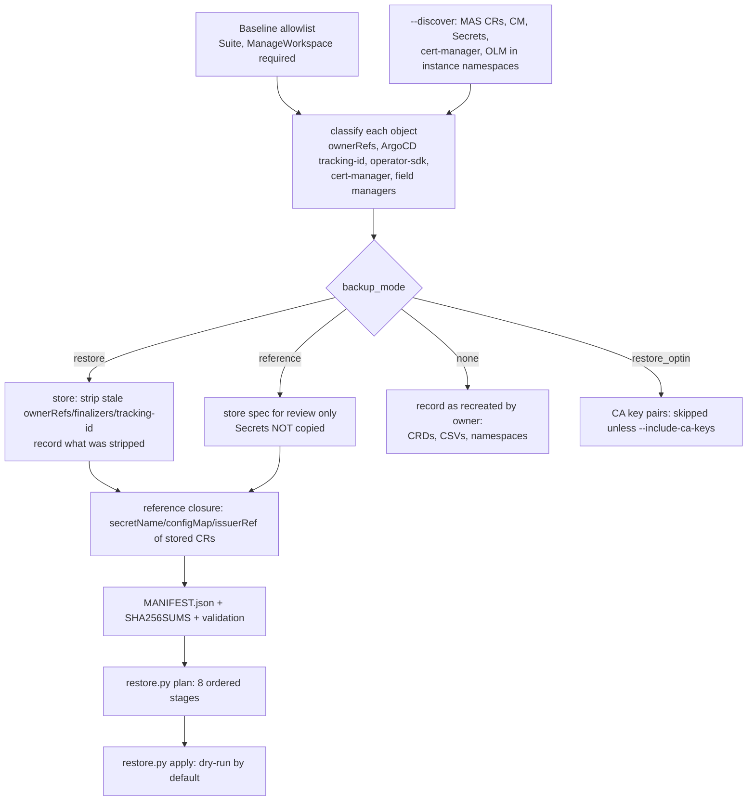

# MASCORE-20742 — Suite and Manage Resource Disaster Recovery POC

## Overview

**Jira:** MASCORE-20742 — POC: automate backup and restore of CRs, Secrets, ConfigMaps and CRDs for SaaS staging instances containing only Manage and Core.

This POC is limited to the two recovery targets: `mas-inst03-core` (Suite) and `mas-inst03-manage` (Manage). Shared services outside these namespaces are dependency references, not a full-cluster inventory. It does **not** export everything and re-apply it. It first **classifies** relevant resources by who owns them, then:

- backs up only what nothing else can recreate (plus reference copies for review),
- records everything that GitOps, operators, OLM or cert-manager will recreate, with the evidence,
- produces a dependency-ordered **recovery plan**, and
- provides a **guarded restore tool** that is plan-only/dry-run by default and refuses to touch the source cluster.

### Status at a glance

| Area | Status | Evidence |
|---|---|---|
| Discovery and ownership classification | **Implemented, tested offline, run read-only against `inst03`** | `discover.py`, `dr_lib.py`, 67 unit/integration tests, one live read-only run (see `POC-RESULTS.md`) |
| Hardened backup with manifest, checksums, validation | **Implemented and tested against a fake `oc`. NOT yet run against the live cluster** | `backup-suite-manage.sh`, `tests/test_dr.py` |
| Recovery planner | **Implemented and tested** | `restore.py plan` |
| Guarded restore (`apply`) | **Implemented, tested only with a mocked `oc`. Never run against any real cluster** | `restore.py apply`, tests |
| Encryption of backups | **Interface only.** No team standard found; you supply `DR_ENCRYPT_CMD` | see [Encryption](#encryption-and-sensitive-data) |
| CA key continuity | **Undecided. CA private keys are not exported by default** | see [CA continuity](#certificates-and-ca-continuity) |
| End-to-end restore on an isolated cluster | **NOT DONE. Unproven.** | no isolated cluster was available |

## Scope and reporting rule (lead feedback)

Organize findings by **Secrets, Custom Resources (CRs), Subscriptions, OLM resources, ConfigMaps, Certificates, and other resources**. The only target namespaces are `mas-inst03-core` and `mas-inst03-manage`. If a target resource depends on `cert-manager`, `mas-inst03-syncres`, `openshift-marketplace`, or another cluster service, document the dependency and its recovery owner separately; do not treat that as permission to inventory the full namespace/cluster. Database backup/restore is outside this story.

## Files

| File | Purpose |
|---|---|
| `dr_lib.py` | Classification, sanitisation, reference extraction, manifest build/validate, dependency ordering, optional external encryption. Also the CLI used by the backup script. |
| `discover.py` | Read-only discovery and classification of one instance (`oc get` only). |
| `backup-suite-manage.sh` | Backup driver: allowlist → optional discovery → reference closure → CA policy → manifest. Edited in place; same entry point as before. |
| `restore.py` | `plan` (never touches a cluster) and `apply` (dry-run by default). |
| `tests/` | `fakes.py` (synthetic cluster and read-only fake `oc`), `test_dr.py`. |
| `backup.sh` | Original Suite-only baseline script, unchanged. |
| `POC-RESULTS.md` | Findings, actual test output, limitations. |
| `backups/` | Generated output. Git-ignored (`.gitignore` change is still uncommitted). |

## Configuration

Environment variables for `backup-suite-manage.sh` and `discover.py`:

| Variable | Default | Meaning |
|---|---|---|
| `INSTANCE` | `inst03` | MAS instance id |
| `WORKSPACE_ID` | `main` | Manage workspace id (previously hard-coded) |
| `CORE_NS`, `MANAGE_NS` | `mas-<instance>-core/-manage` | In-scope target namespaces |\n| `SYNCRES_NS` | `mas-<instance>-syncres` | External dependency reference only; not part of the target namespace inventory |
| `CERT_NS` | `cert-manager` | cert-manager namespace |
| `DR_ENCRYPT_CMD` | unset | Command that reads plaintext on stdin and writes ciphertext on stdout |
| `DR_DECRYPT_CMD` | unset | Inverse command, needed by `restore.py` for encrypted backups |

Backup options: `--discover`, `--include-ca-keys` (requires `DR_ENCRYPT_CMD`), `--store-reference-secrets` (break-glass), `--allow-plaintext-local`.

## Architecture and workflow



Every stored object is written to disk by `dr_lib.py store`; the shell only fetches. Failures are never silent: a missing optional object is recorded in `skipped`; a missing **required** object fails the run (exit 2) and the manifest.

## Resource classification rules

Implemented in `dr_lib.classify()`. Evidence comes from object **metadata**, not names. The order matters; first match wins.

| Rule | Evidence | Category | Recovery action | Stored as |
|---|---|---|---|---|
| CRD without GitOps tracking | `kind` | operator_managed | `install_operator` | not stored |
| ClusterServiceVersion | `kind`, OLM annotations | operator_managed | `install_operator` | not stored |
| Namespace | `kind` | unknown (flagged: creator unverified) | `create_namespace` | not stored |
| ArgoCD `tracking-id` annotation | annotation | gitops_managed (Secret: externally_sourced, *inferred*) | `gitops_resync` (+ AWS SM for Secrets) | reference (Secrets not copied) |
| Secret named as a CA by an Issuer/ClusterIssuer (`spec.ca.secretName`) | issuer spec | operator_managed | `ca_continuity_decision` | opt-in only |
| `ownerReferences`, `operator-sdk/primary-resource`, or `cert-manager.io/certificate-name` | metadata | operator_managed | `recreate_operator` / `recreate_cert_manager` | reference |
| …and the Secret matches a **state-bearing policy hint** | name regex (policy, not ownership) | operator_managed | `backup_restore_pre_reconcile` | **restore, required** |
| `pre-jreporter-*-synctime` ConfigMap, no owner | name regex + chart evidence | toolchain_managed | `recreated_by_sync_hook` | reference |
| Tekton/Helm markers only | labels/annotations | toolchain_managed (ambiguous) | `rerun_toolchain` | reference |
| `kubectl`/`oc` field manager only | `managedFields` | manual_or_app_created (ambiguous) | `backup_restore` | restore |
| nothing | — | unknown (ambiguous) | `review_manually` | opt-in only |

Default state-bearing hints: `encryption-secret`, `-keys-(jwt|ltpa)`, `-credentials-superuser`. They are a **configurable policy** (`--state-hint`), applied only after ownership evidence; the reasoning is that regenerating them would orphan data or sessions that depend on the old value. Whether regeneration really would is **unproven** (see limitations).

`confidence` is `observed` (direct marker) or `inferred`. Anything ambiguous carries `ambiguity_reason`.

### Metadata sanitisation

- Always removed: `uid`, `resourceVersion`, `creationTimestamp`, `generation`, `managedFields`, `selfLink`, `status`, `last-applied-configuration` (can duplicate the spec with credentials).
- Removed **only for restorable objects**: `ownerReferences` (a stale owner UID makes the garbage collector delete the restored object), `finalizers`, ArgoCD `tracking-id`. The manifest records exactly what was removed (`stripped`).
- Reference copies keep all ownership metadata unchanged.

## Resources Created

Per backup, in the output directory (all mode `0600`, directories `0700`):

| Path | Content |
|---|---|
| `core/ manage/ syncres/ cert-manager/ cluster/` | One sanitised object per file (`.yaml`, or `.yaml.enc` when encrypted) |
| `MANIFEST.json` | Entries (id, kind, category, evidence, recovery action, depends_on, file, sha256, `stripped`, secret **key names only**), `skipped`, `not_backed_up`, validation result |
| `SHA256SUMS` | Checksums of every stored object file and of `MANIFEST.json`. **Not covered:** `inventory.json`, `inventory.txt`, and `README.txt` (human-readable/metadata files; no credential content). `SHA256SUMS` is an integrity check, not a digital signature: an attacker who can overwrite the backup directory can rewrite both the files and `SHA256SUMS`. |
| `inventory.json`, `inventory.txt` | Discovery output (with `--discover`) — not covered by `SHA256SUMS` |
| `README.txt` | Short note for whoever holds the directory — not covered by `SHA256SUMS` |

The pre-existing run `backups/inst03-20261023-174100` was produced by the **old** script. It has no manifest, still contains operator `ownerReferences` and was not re-validated by the new tooling.

## Examples

```bash
# run from the root of the gitops repository
# 1. read-only discovery and classification (no files with data are written)
python3 poc/suite-resource-dr/discover.py --instance inst03 --output /secure/path/inventory.json

# 2. backup. Encrypted (preferred; command supplied by you):
DR_ENCRYPT_CMD='<approved-encrypt-command>' bash poc/suite-resource-dr/backup-suite-manage.sh --discover
#    or a local-only, unencrypted POC copy:
bash poc/suite-resource-dr/backup-suite-manage.sh --discover --allow-plaintext-local

# 3. verify an existing backup (checksums, permissions, metadata rules)
python3 poc/suite-resource-dr/dr_lib.py verify --out poc/suite-resource-dr/backups/<dir>

# 4. plan (never touches a cluster)
python3 poc/suite-resource-dr/restore.py plan --backup poc/suite-resource-dr/backups/<dir>

# 5. dry-run against an ISOLATED target cluster (server-side dry-run; creates nothing)
oc login <isolated-cluster>
python3 poc/suite-resource-dr/restore.py apply --backup <dir> --target-server "$(oc whoami --show-server)"
# 6. only after reviewing the dry-run: really create (never overwrites; `oc create`)
#    REQUIRES an encrypted backup (DR_ENCRYPT_CMD must have been set at backup time).
DR_DECRYPT_CMD='<approved-decrypt-command>' \
  python3 poc/suite-resource-dr/restore.py apply --backup <dir> --target-server "$(oc whoami --show-server)" --execute
```

`apply` refuses to run when: the logged-in server is the backup's source server, the current context equals the source context, `--target-server` does not match the logged-in server, the backup fails checksum/permission/metadata validation, a target namespace is missing, an API/CRD is not installed, or **`--execute` is given with a plaintext backup** (encryption approval is a prerequisite for actual execution — see [Encryption and sensitive data](#encryption-and-sensitive-data)). It stops at the first failure. Objects that already exist are skipped unless `--overwrite` is given. Dry-run (without `--execute`) is always available regardless of whether the backup is encrypted.

**Never run `apply` against `inst03` (cluster `noble8`).** Restore is also unsafe on any cluster where an ArgoCD application still manages the same objects: it will fight the restore (`selfHeal: true`).

## Encryption and sensitive data

**Finding:** no encryption standard for backups exists in the six repositories. Searches for sops, git-crypt, age, gpg, ansible-vault, sealed-secrets, ExternalSecret and KMS usage found nothing relevant. What does exist: `detect-secrets` pre-commit hooks in `saas-deploy-py`, `saas-tekton` and `cli` (not in `gitops`), and runtime secrets sourced from AWS Secrets Manager (instances) and IBM Cloud Secrets Manager (pipelines). Neither is a backup-encryption standard, so none was chosen.

What the tooling does instead:

- Refuses to run without `DR_ENCRYPT_CMD` unless `--allow-plaintext-local` is passed explicitly.
- When `DR_ENCRYPT_CMD` is set, every stored object is piped through it; checksums cover the **ciphertext**. The tool never stores keys or recipients.
- A failing or empty encrypt command aborts the store.
- Reports, logs, inventories and the manifest contain Secret **key names only**; tests assert a sentinel secret value never appears in any output (including when `--store-reference-secrets` is used).
- CA private keys are never written in plaintext (`--include-ca-keys` requires `DR_ENCRYPT_CMD`).
- Reference-only Secrets (GitOps/operator regenerated) are not copied at all unless `--store-reference-secrets`.

**Important limitations:**
- **Checksums verify ciphertext integrity only.** A checksum pass does not prove the backup is decryptable. If `DR_ENCRYPT_CMD` and `DR_DECRYPT_CMD` are mismatched (wrong key, rotated key, command error), the backup passes verification but fails at restore time. The only way to confirm recoverability is to decrypt a test file and inspect the result.
- **`SHA256SUMS` is not a digital signature.** It cannot protect against an attacker who has write access to the backup directory and can rewrite both the object files and `SHA256SUMS`. Off-host, access-controlled storage is required to make the integrity guarantee meaningful.

**Blocker:** the team must approve a mechanism and key custody (e.g. a KMS/AWS-backed approach) and an off-host storage location. `DR_ENCRYPT_CMD` / `DR_DECRYPT_CMD` are the integration points. The tests use a base64 stand-in that is **not** encryption.

## Certificates and CA continuity

Verified on `inst03`: the `ClusterIssuer`s use `spec.ca.secretName` → `inst03-cert-internal-ca` / `inst03-cert-public-ca`; those Secrets are the CA key pairs minted by cert-manager from self-signed Issuers via `Certificate` CRs created by the Suite operator (`operator-sdk/primary-resource` annotations). The original backup did **not** contain them.

If the CA Secrets are not restored, cert-manager mints a **new** CA and re-issues dependants. Whether MAS components, truststores or external clients tolerate that is **unverified**. `inst03` has `mas_manual_cert_mgmt: false`. A Suite `internalCertificateAuthority` setting exists and is passed through by the gitops chart and cli templates, but its semantics could not be verified (operator source not in the workspace).

Options for the Suite team to decide: (A) accept a new CA and document re-trust steps; (B) export the CA key pairs encrypted (`--include-ca-keys`) and restore with `--include-optin`; (C) use a customer-supplied CA if `internalCertificateAuthority` supports it. Until decided, the tooling records the CA Secrets as `skipped_policy` with action `ca_continuity_decision`.

## CRDs and OLM / operator lifecycle

- CRDs, ClusterServiceVersions, Subscriptions, OperatorGroups and CatalogSources are **never restored from a backup**. Discovery records them with their recovery source.
- Verified in the gitops repo: CatalogSource from `cluster-applications/000-ibm-operator-catalog`; cert-manager from `cluster-applications/010-redhat-cert-manager`; the ibm-mas Subscription and OperatorGroup are rendered by `instance-applications/130-ibm-mas-suite`. CRDs arrive with the operator CSV.
- `restore.py apply` checks the API group exists on the target and stops with "API/CRD not installed" otherwise.
- Operator versions must match the source; the plan lists this as a stage-2 prerequisite. Version pinning is not automated.
- Two `ibm-truststore-mgr` Subscriptions were classed `unknown` (no tracking or owner): their origin is unverified.

## Recovery order

`restore.py plan` emits eight stages (deterministic; dependencies first, then stage, kind, namespace, name):

1. Cluster and namespace prerequisites (isolated cluster, namespaces, storage class)
2. Catalogs, subscriptions, operators and CRDs (via GitOps/OLM)
3. GitOps/toolchain reconstruction (ArgoCD apps from `gitops-envs`/`saas-envs`; **set `mas_wipe_mongo_data: false` and isolated DB/AWS paths**)
4. Externally sourced Secrets and manual inputs (AWS Secrets Manager values, database restores — separate Jira stories)
5. Explicitly backed-up resources (restorable Secrets/ConfigMaps)
6. Certificates, issuers, CA continuity
7. Custom resources and operator reconciliation (let operators reconcile; ManageDeployment etc. are not restored)
8. Final validation

Manual prerequisites that remain: the isolated cluster, AWS Secrets Manager entries for the target, database restoration, and the CA/encryption/key decisions above. **Dependencies on other stories:** Db2/Mongo/SLS data backup and replication are explicitly out of scope here; the Manage encryption Secrets only help if they match the restored database content.

## Tests and validation

Run from the repository root (about 90 s; no cluster, network, or `pytest` needed):

```bash
python3 -m unittest discover -s poc/suite-resource-dr/tests -v
bash -n poc/suite-resource-dr/backup-suite-manage.sh poc/suite-resource-dr/backup.sh
python3 -m py_compile poc/suite-resource-dr/*.py poc/suite-resource-dr/tests/*.py
git diff --check
```

Coverage: classification (incl. "name alone is not ownership"), sanitisation (restore vs reference), reference extraction, deterministic ordering and cycle detection, backup end-to-end via a read-only fake `oc` (required/optional failures, duplicates, CA policy, reference-secret policy, permissions, no secret values in output including with `--store-reference-secrets`, encryption interface, tamper detection), discovery scoping (non-MAS CRDs and platform noise excluded), restore safety:

- **F-06:** source-cluster and source-context identity checks; explicit error when source identity was not recorded at backup time (no silent degradation).
- **F-08:** `--execute` is refused for plaintext backups; no mutating `oc` call is made before the gate fires; dry-run remains available for plaintext backups.
- **F-09/M-02:** cross-stage dependency ordering: a resource whose dependency lives in a higher-numbered stage is raised to that stage before sorting, preventing inversion.
- **F-11:** `ok_no_skips` / `skipped_required_ids` / `warnings` fields; CLI exits 5 (not 0) when required resources were skipped during `--execute`.
- **F-12/F-03:** encrypt failure on a required resource is recorded in `manifest["skipped"]` as `status: failed`; the backup exits nonzero and validation fails.

Actual results are in `POC-RESULTS.md`.

### Latest local validation

- **Unit tests:** 96 passed; completed on 2026-10-26.
- **Test mode:** offline tests using mocked `oc`; this does not establish live-cluster recovery.
- **Live restore:** not performed; isolated-cluster acceptance criteria remain outstanding.
- **Security note:** do not commit or share plaintext backup artifacts.

## Isolated restore: instructions and acceptance criteria

**Requires an isolated cluster and explicit authorization. Not performed.**

Prerequisites: separate cluster; separate AWS Secrets Manager paths and databases (or restored copies) for the test instance; `mas_wipe_mongo_data: false`; approved decrypt capability; same MAS and operator versions; no ArgoCD application on the target managing the same objects until stage 3.

Steps: run stages 1–4 of `restore.py plan`; `restore.py apply` (dry-run), review; `apply --execute`; let operators reconcile; run stage 8 checks.

Acceptance criteria:

- [ ] `Suite` and `ManageWorkspace` report Ready; no restored object is garbage-collected.
- [ ] cert-manager Certificates and ClusterIssuers Ready.
- [ ] Manage pods running and a login succeeds.
- [ ] A Manage field encrypted before the backup is readable after restore (proves encryption-secret continuity).
- [ ] Operators adopt (do not regenerate or overwrite) the restored Secrets.
- [ ] Result recorded in `POC-RESULTS.md` with the exact commands.

If no isolated cluster is available, what can be validated safely: offline tests, `plan`, `verify`, read-only discovery. What remains unproven: operator adoption of restored Secrets, behaviour without the CA keys, GC behaviour, Manage data decryption, and the whole recovery chain.

## Known limitations and open items

- No end-to-end restore has ever been run. The restore path has only been exercised with a mocked `oc`.
- The new `backup-suite-manage.sh` has **not** been run against the live cluster; only the older script has.
- No `CustomResourceDefinition` manifests are produced by design; CRD/operator version pinning is not automated.
- The "state-bearing Secret" hints are policy assumptions. Several are operator-owned and may be regenerable; this needs the isolated test and Suite-team confirmation.
- `kubectl-*` field managers do not prove manual creation (in-cluster hook Jobs use kubectl). They are flagged ambiguous; one known false positive (`pre-jreporter-*-synctime`) is handled by a documented hint.
- Config CRs (JdbcCfg, MongoCfg, SlsCfg, BasCfg, …) and ManageApp are rendered by GitOps charts; they are classified from live objects but their authoritative values live in `gitops-envs`/`saas-envs` and AWS Secrets Manager.
- Reusing `mas backup`/`mas restore` from the `cli` repo was evaluated and **not** adopted: it targets MongoDB CE, standalone `Db2uCluster` (not `Db2uInstance`), and applies CRs directly, which conflicts with ArgoCD `selfHeal`. The Ansible role source was not in the workspace, so the roles themselves were not inspected. The legacy `cli/image/cli/mascli/backup-restore/*.sh` scripts were used only as a pattern (ownerReference stripping, `secretName` discovery).
- `enhanced_dr` (inst03: `false`) is typed as an object in gitops docs and a boolean in the `saas-deploy-py` schema; its effect was not determined.
- `saas-envs/manual-certs/*/tls.key` files exist for `fvtsaas`; they were not opened. Confirm they are encrypted or intentionally public-test material.
- Namespace creator is unverified.
- No changes were required in `saas-deploy-py`, `saas-tekton`, `gitops-envs` or `saas-envs`. `gitops/.gitignore` has an uncommitted line excluding `backups/`; `poc/` is untracked.

## Conclusion

The POC now classifies resources by evidence, backs up only what needs it, validates the result with checksums and a manifest, and produces an ordered, guarded recovery plan. It has **not** demonstrated recovery. The next gating steps are an isolated cluster test and decisions on encryption, CA continuity and the state-bearing Secret list.
